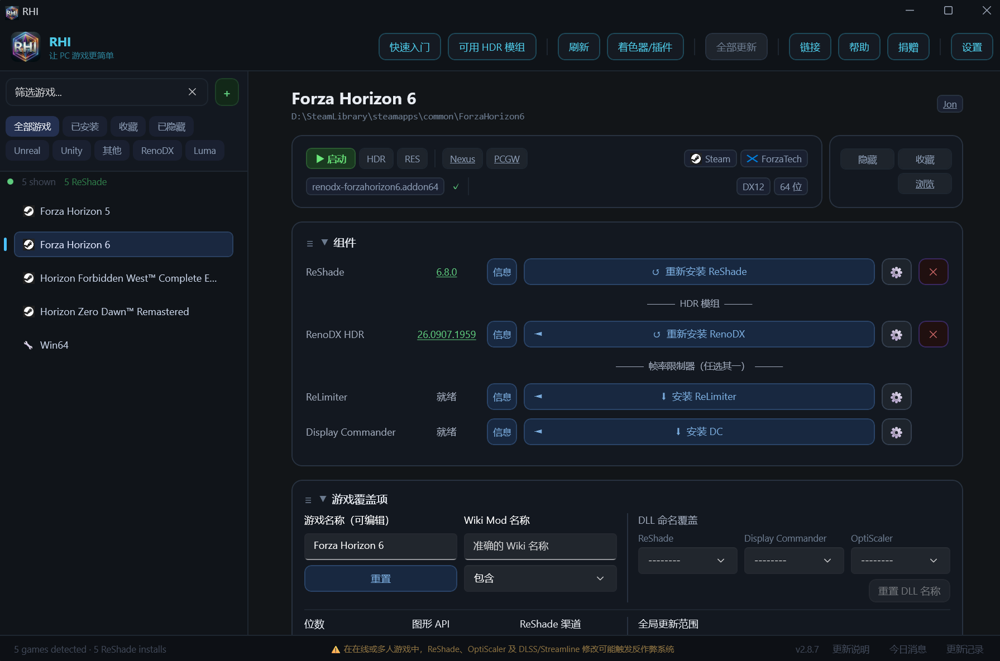

# RHI — ReShade HDR 安装器 (简体中文版)

**一个工具，覆盖所有游戏。在单一窗口中完成 HDR、DLSS 与 NVIDIA 驱动管理。**

---

## 项目简介与来源

- **原项目仓库**：[RankFTW/RHI](https://github.com/RankFTW/RHI)（原作者：[RankFTW](https://github.com/RankFTW)）
- **中文汉化仓库**：[XYZ-ZJ/RHI-CN](https://github.com/XYZ-ZJ/RHI-CN)
- **汉化方案**：源码内置简体中文，无外部翻译 API 依赖。

本项目是对上游 [RankFTW/RHI](https://github.com/RankFTW/RHI) 的**全量简体中文本地化版本**。不仅汉化了主窗口静态界面与设置，还完成了对全部 205 处悬停提示（Tooltip）、动态状态文案、冲突警告弹窗、NVIDIA 驱动设置选项以及内置“快速入门指南 (FAQ)”的深度汉化，同时保持所有专有名词、API 标识符与配置键的原始兼容性。

---

## 核心功能

### 一键 HDR，覆盖每款游戏

- **[RenoDX](https://github.com/clshortfuse/renodx)** — 自动检测并为每款游戏安装合适的 HDR 模组。内置数百个针对具体游戏的定制模组；对于没有专属模组的游戏，还为所有虚幻引擎和 Unity 游戏提供通用 HDR 支持。
- **UE-Extended** — 所有未命名模组的虚幻引擎游戏默认方案。自动以正确的 HDR 设置配置 `reshade.ini` 和 `Engine.ini`，无需手动编辑 ini。
- **[Luma Framework](https://github.com/Filoppi/Luma-Framework)** — 游戏库中的每款 DX11 虚幻引擎游戏都会自动获得一行 Luma 条目。受支持的游戏有专属模组，其余游戏提供通用支持。Engine.ini 键值、启动参数和 TAA 设置会在安装时自动从 wiki 应用。
- **[DXVK + Lilium HDR](https://github.com/EndlesslyFlowering/dxvk)** — 为通常完全没有 HDR 输出通道的老旧 DX9 游戏带来 scRGB HDR 输出。
- **[RenoFX HDR Toolkit](https://github.com/clshortfuse/renofx)** — 为尚无专属 RenoDX 模组的游戏提供 SDR 转 HDR 方案。

### ReShade — 全托管

RHI 完全取代 ReShade 官方安装器。

- 通过 PE 二进制扫描检测每款游戏的图形 API，并自动把 DLL 命名为正确的名称 — `dxgi.dll`、`d3d9.dll`、`opengl32.dll`。
- 每次启动时自动预下载最新稳定版（Stable）与每日构建版（Nightly）。
- 每款游戏可选渠道：Stable、Nightly、Custom、Legacy 或 No Addons，可在整个游戏库中自由混搭。
- Vulkan 游戏使用全局隐式层 — 一键安装，无需手动操作。
- 外来 DLL 检测：如果游戏目录中已有其他工具（DXVK、Special K、ENB），覆盖任何文件前都会弹出中文预警。
- `reshade.ini` 自动生成并合并 — 快捷键、截图路径、峰值亮度与 DLSS 路径全部无需手动配置。

### DLSS 5 与神经渲染

- **DLSS5 Feeder** — 一键完整安装：部署 Feeder 插件、DLSS5 consumer、`nvngx_dlss.dll`、`nvngx_dlssnr.dll`、预配置的 `ReShadePreset.ini` 以及所需的着色器包。自动为你的游戏选择合适的方法（32 位、DX11、DX12）。
- **ShortFuse DLSS Tool** — 面向 DX12 游戏的另一种神经渲染实现。
- **DX11 Bridge 变体** — DLSS5 Tool + 桥接层，适配需要 DX11 兼容的游戏。
- **NR Cost Scaler** — 包装 `nvngx_dlssnr.dll`，以更低的开销运行神经渲染（默认 75%）。安装方法前打开开关即可自动部署。

### DLSS 与 Streamline 版本管理器

- 通过下拉菜单为每款游戏切换 SR、RR、FG 和 Streamline 版本。涵盖 2.x 至当前的每个版本，另支持 Custom 自定义文件。
- 原始 DLL 自动备份，随时可一键还原。
- 一次性设置全局默认值 — 一键“快速应用”即可推送到任意游戏。
- 批量部署：从清单中勾选多个游戏，一次性推送版本、预设和渲染缩放。
- DLSS 预设（SR 的 J/K/L/M、RR 的 D/E、FG 的 A/B）直接写入 NVIDIA 驱动配置，无需 Profile Inspector。
- **DLSS SR 渲染缩放覆盖** — 为每款游戏强制 33–100% 的渲染分辨率。
- **NVIDIA 覆盖** — 直接在版本下拉菜单中设置驱动的“最新 DLL”标志，效果等同于在 NVIDIA App 或 Profile Inspector 中启用。
- DLSS SR、RR、FG 支持从 RHI 清单自动更新，按游戏选择启用。

### 多帧生成（MFG）解锁

- **RTX 40 MFG 解锁** — 通过 Ultimate ASI Loader 在 RTX 40 系上启用超过 2x 的 DLSS MFG 倍数（最高 6x）。在扩展（Extras）区一键安装。
- **MFG Ada Unlock** — 通过插件管理器为 RTX 40 系提供内存中的 MFG 解锁插件。
- **RTX 50 系 MFG** — 在 DLSS 区配置 Fixed / Dynamic MFG 模式、帧数（2x–6x）和动态目标帧率。

### OptiScaler

- 将 DLSS API 调用重定向到 FSR4/FSR3/XeSS，适配 AMD 与 Intel 显卡，并为游戏本身不支持帧生成的场合添加帧生成支持。
- 每款游戏可选 **Stable 与 Nightly 渠道**，在齿轮菜单中选择。
- **按 GPU 预设的 INI 模板** — 六套预配置模板（NVIDIA、AMD+DLSS、AMD 无 DLSS，各分 Stable/Nightly）。首次启动时生成，用户可自行编辑，永远不会被覆盖。
- **Streamline + DLSS Enabler 部署**（Nightly）— 按游戏开关，向 OptiScaler 目录部署 Streamline DLL 与 DLSS Enabler，可按游戏选择 Streamline 版本。
- 帧生成设置：FG Input、FG Output、FG Nvngx Replacement、HUD Fix — 全部可在齿轮菜单中配置。
- **OptiPatcher** 自动部署到所有装有 OptiScaler 的游戏，静默自动更新。
- 自动处理与 ReShade 的共存 — 调整文件名并设置 `LoadReshade=true`。

### 帧率限制器

两款按游戏启用的帧率限制器，互斥使用：

- **[ReLimiter](https://github.com/RankFTW/ReLimiter)** — 精准帧节奏控制，具备预测性睡眠、相位锁定时序网格与闭环校正。感知 VRR，自适应 DLSS FG，集成 Reflex。
- **[Display Commander](https://github.com/pmnoxx/display-commander)** — 备选限制器，同时支持 32 位与 64 位游戏。

两者都作为 ReShade 插件部署，都参与“全部更新”。

### NVIDIA 驱动配置管理 — 取代 NVIDIA App 与 Profile Inspector

所有按游戏的驱动设置都通过 NvAPI 直接写入。无需 NVIDIA Profile Inspector，无需 NVIDIA App。

**按游戏覆盖：**
- VSync 模式、撕裂控制、低延迟（关 / 开 / Ultra）
- 平滑运动（Smooth Motion）：启用、允许的 API、翻转节奏 — 启用时自动将低延迟设为 Ultra
- 电源管理模式（自适应 / 最佳性能 / 最高性能）
- 按游戏开关 G-Sync
- ReBAR：启用（关 / 开 / 自动）、模式（标准 / 优化）、容量上限
- RTX HDR：启用 / 配置峰值亮度、对比度、饱和度、中间灰、去带
- DLSS 预设与渲染缩放覆盖（无需管理员权限）

**全局设置（基础配置文件）：**
- 着色器缓存大小与预编译
- G-Sync 模式与首选刷新率
- 全局 ReBAR
- FPS 限制（Frame Rate Limiter V3）
- 按显示器的数字振动 — 每次应用启动时自动恢复

**导出 / 导入：** 将所有按游戏的 NVIDIA 配置备份为 JSON 文件。重装驱动后导入即可完整恢复。

### HDR 自动切换

通过 RHI 启动游戏时自动开启 Windows HDR，游戏关闭时自动关闭。支持 Steam、Epic、Xbox 和直接启动 exe。启动按钮旁有按游戏覆盖的开关 — 生效时呈紫色。

### 着色器包管理 — 46 个包

- **必备**：Lilium HDR Shaders（EndlesslyFlowering）— HDR 色调映射所必需
- **推荐**：crosire reshade-shaders、PumboAutoHDR、MaxG2D Simple HDR、clshortfuse shaders、RenoFX HDR Toolkit、smolbbsoop shaders
- **扩展**：另有 39 个包 — SweetFX、OtisFX、qUINT、iMMERSE、Prod80、CorgiFX、ZenteonFX、CRT-Royale、VRToolkit、GShade-Shaders、QD-OLED APL Fixer、LumaBoost 等等

可全局选择着色器包，也可按游戏覆盖。展开任意包可挑选单个 `.fx` 文件。可将选择保存为命名配置，导出为 zip，或直接分享到 Discord。自定义着色器放在 `%LocalAppData%\RHI\Custom\reshade\Shaders\` — RHI 会把它们与托管包一起部署。

### 一键全部更新

工具栏上的一个按钮即可更新整个游戏库的 ReShade、RenoDX、ReLimiter、Display Commander、OptiScaler 和 RE Framework。支持按游戏排除更新。有可用更新时按钮亮紫色。运行期间每 4 小时后台检查一次 — 通过系统托盘工作，无需保持窗口打开。

---

## 支持的游戏商店与平台

Steam · Epic Games · GOG · Xbox / Game Pass · EA App · Ubisoft Connect · Battle.net · Rockstar · itch.io

如果游戏未被自动检测，把它的 `.exe` 拖放到 RHI 窗口中即可手动添加。

---

## 编译与发布说明

本项目基于 .NET 8 与 WinUI 3 开发。

### 远程自动编译与发布

本项目已配置 **GitHub Actions 远程云端自动编译与发布工作流**。

- 每次向 `main` 分支提交或推送版本标签（`v*`）时，GitHub Actions 会自动在干净的 Windows 云端虚拟环境中拉取代码、执行自包含单文件发布、自动打包 ZIP 便携包并在 [Releases](https://github.com/XYZ-ZJ/RHI-CN/releases) 中生成最新发布版本。
- 本地开发者仅需专注于汉化翻译与代码审查，无需在本地配置繁杂的编译产物管理。可在仓库页面的 **Actions** 标签页查看实时构建日志与下载构建工件。

---

## 项目维护文档

关于本地汉化维护、代码审查流程、源码模块索引及 CI/CD 工作流的完整说明，请参阅：
- **[RHI 简体中文项目维护文档](docs/maintenance/README.md)**

---

## 系统要求

- Windows 10 / 11 64位
- [.NET 8 Desktop Runtime](https://dotnet.microsoft.com/download/dotnet/8.0)
- 驱动配置功能建议使用 NVIDIA 显卡（ReShade 与 RenoDX 在所有显卡上均可用）
- 以下功能需要管理员权限：ReBAR、平滑运动（Smooth Motion）、低延迟（Ultra）、Vulkan ReShade 隐式层安装、驱动配置导出/导入

---

## 鸣谢与上游开源组件

- **上游原项目**：[RankFTW/RHI](https://github.com/RankFTW/RHI) by [RankFTW](https://github.com/RankFTW)
- [ReShade](https://reshade.me) by Crosire
- [RenoDX](https://github.com/clshortfuse/renodx) by clshortfuse 及贡献者
- [ReLimiter](https://github.com/RankFTW/ReLimiter) by RankFTW
- [Display Commander](https://github.com/pmnoxx/display-commander) by pmnoxx
- [RE Framework](https://github.com/praydog/REFramework-nightly) by praydog
- [Luma Framework](https://github.com/Filoppi/Luma-Framework) by Pumbo (Filoppi)
- [OptiScaler](https://github.com/optiscaler/OptiScaler) by OptiScaler 贡献者
- [DXVK](https://github.com/doitsujin/dxvk) by doitsujin 及贡献者
- [DXVK HDR-mod](https://github.com/EndlesslyFlowering/dxvk) by EndlesslyFlowering (Lilium)
- [Ultimate ASI Loader](https://github.com/ThirteenAG/Ultimate-ASI-Loader) by ThirteenAG